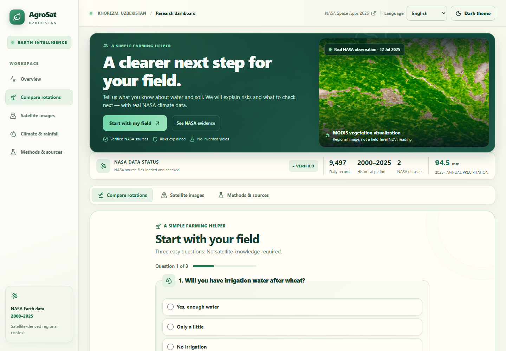
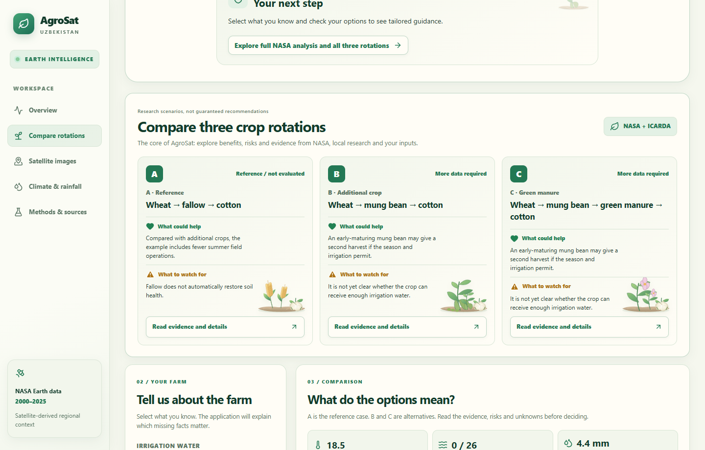

<div align="center">

# 🌱 AgroSat Uzbekistan

### Smarter crop rotation decisions, grounded in NASA Earth observations.

**NASA Space Apps Challenge 2026 · Field Shift: Adapting Farms with NASA Data**

[](https://www.spaceappschallenge.org/2026/challenges/field-shift-adapting-farms-with-nasa-data/)


**Real climate evidence · Clear uncertainty · Farmer-first design**

[](https://github.com/thezxcc/AgroSat-Uzbekistan/actions/workflows/ci.yml)

[Explore the challenge](https://www.spaceappschallenge.org/2026/challenges/field-shift-adapting-farms-with-nasa-data/) · [View the 7-slide presentation](presentation/AgroSat_Uzbekistan_NASA_2026_FINAL.pdf) · [Browse our sources](docs/DATA_SOURCES_AND_CREDITS.md) · [How to run](QUICKSTART.md) · [Judge guide](JUDGES_GUIDE.md)

</div>

---

## For NASA Space Apps judges — start here

**AgroSat in one sentence:** A multilingual, evidence-first tool that helps farmers in Khorezm, Uzbekistan compare three wheat–cotton crop rotation scenarios using real NASA climate records, scientific references and their own water/soil constraints.

| **1. Understand** | **2. Run** | **3. Verify** |
|:---|:---|:---|
| [7-slide project presentation](presentation/AgroSat_Uzbekistan_NASA_2026_FINAL.pdf) | [One-command setup](QUICKSTART.md) | [2-minute jury walkthrough](JUDGES_GUIDE.md) |
| [Where the NASA data came from](docs/DATA_SOURCES_AND_CREDITS.md) | [Windows one-click launcher](START_HERE.bat) | [Automated checks](https://github.com/thezxcc/AgroSat-Uzbekistan/actions/workflows/ci.yml) |

### Launch the complete app with one command

After **[cloning or downloading the repository](QUICKSTART.md)**, open a terminal **in the project folder** (Docker with Compose v2 required):

```bash
docker compose up --build
```

Then open **http://localhost:8080**. This starts **both the React website and the FastAPI/NASA-data service**. No API key, database setup or .env file is required. The first build downloads dependencies. Stop with **Ctrl+C**.

**No Docker?** Windows: double-click [`START_HERE.bat`](START_HERE.bat). macOS/Linux: `python3 run.py` (Python 3.12+ and Node.js 22.12+/24+ required). See the **[complete Quick Start Guide](QUICKSTART.md)**.

**What to try in 2 minutes:** open the site → answer the three field questions → compare **A / B / C** → open the evidence and NASA climate data. For exactly what to look for, see the [jury walkthrough](JUDGES_GUIDE.md).

> **Scope:** This is a working educational research prototype, **not** a field-validated yield or water-savings prediction. No hosted public demo is claimed; the repository contains a reproducible local launch and its underlying NASA data.



## The idea

**What should a farmer grow after harvesting wheat?**

In Khorezm, Uzbekistan, that decision depends on much more than the season. Irrigation water may be limited, soils may be saline, and an additional crop needs enough time before the next planting.

**AgroSat** is an educational decision-support prototype that combines **26 years of NASA climate history**, regional crop research and information provided by the farmer. Instead of making an unjustified recommendation, it helps users understand **what might work, what could go wrong and what to check next**.

> **Our principle:** Satellite data can explain regional climate conditions. It cannot tell us how much canal water reached one field or replace a laboratory soil test.

## Explore three pathways

| | Example sequence | What the prototype investigates |
|:--:|---|---|
| **A** | Wheat → fallow → cotton | Illustrative reference scenario; **not** a claim about the farmer's actual rotation |
| **B** | Wheat → mung bean → cotton | Potential extra crop, conditional on irrigation and a feasible growing season |
| **C** | Wheat → mung bean → winter pea green manure → cotton | Added soil-management stage with **additional** water, labour and seasonal constraints |



The three options are **research scenarios**, not a ranked list of guaranteed outcomes. They are not presented as three measured treatments from a single trial.

## How AgroSat works

```text
NASA climate records       Local crop research        Farmer's field context
IMERG + POWER              ICARDA + FAO              Water · Soil · Priorities
       \                         |                          /
        └────────────────────────┼─────────────────────────┘
                                 ▼
                    Explainable comparison engine
                                 ▼
                 A / B / C · Risks · Missing evidence
                                 ▼
                         What to check next
```

1. **Answer three easy questions** about irrigation, soil salinity and your main goal. “I don't know” is a valid answer.
2. **Explore A, B and C**, including one clear potential advantage and one important caution per scenario.
3. **Open the evidence when needed**: crop calendars, NASA observations, the six-factor assessment and original scientific sources.
4. **Check the next action** before making a farm decision — such as confirming canal-water delivery or obtaining a soil test.

### Key features

- **EN / RU / UZ interface** with approachable wording, illustrations and light/dark themes.
- **Original NASA time series** for rainfall, heat and frost exposure — including historical 75-day windows.
- **Explainable, qualitative trade-offs** for water, soil cover, nutrients, pests, field operations and market considerations.
- **Calendar checks** for contradictory or missing sowing/harvest dates, including the separate winter green-manure stage.
- **Optional real field information**: farmer-reported irrigation amount, soil ECe, pH, sampling details and their source.
- **Research transparency**: citations, data provenance, unknowns and limitations are accessible in the interface.

## NASA data used

The pilot climate point is near **Urgench, Khorezm (41.55° N, 60.62° E)**. Data cover **1 January 2000 – 31 December 2025**: **9,497 daily dates** per climate series.

| Input | Product / parameter | How we use it |
|---|---|---|
| Precipitation | **NASA GPM IMERG**, `IMERG_PRECTOT`, delivered via **NASA POWER Daily API** | Historical daily, monthly and annual precipitation |
| Temperature | **NASA POWER** `T2M`, `T2M_MAX`, `T2M_MIN` | Historical hot/frost days and seasonal exposure |
| Vegetation imagery | **NASA GIBS / MODIS** regional images (2025) | Visual context only — **not** numerical field NDVI |

**Data integrity:** Original NASA JSON inputs and their SHA-256 hashes are tracked in [the source manifest](backend/data/NASA_SOURCES_MANIFEST.json). The code recomputes climate summaries from those files rather than using invented numbers.

**Illustrative result:** The archived NASA IMERG-derived 2025 annual precipitation at the pilot point is **94.47 mm**. That does **not** represent water delivered through irrigation canals.

> **What AgroSat does not predict:** farm-specific yields, profit, irrigation savings, laboratory salinity, crop classification, field-level NDVI or the success of a planting decision. Satellite climate cells are regional estimates, not field measurements.

## Research and source credits

The figures and crop assumptions are **not made up**. This project builds on the following identifiable primary sources:

| Source | Purpose | Original reference |
|---|---|---|
| **NASA POWER** | Daily meteorology and data access | [POWER Daily API documentation](https://power.larc.nasa.gov/docs/services/api/temporal/daily/) |
| **NASA GPM / IMERG** | Precipitation product represented in POWER | [GPM IMERG](https://gpm.nasa.gov/data/imerg) · [POWER data-source methodology](https://power.larc.nasa.gov/docs/methodology/data/sources_meteorology/) |
| **NASA GIBS** | MODIS imagery used for regional visualization | [Global Imagery Browse Services](https://gibs.earthdata.nasa.gov/) |
| **ICARDA / CGIAR (2022)** | Early Durdona mung bean example in Khorezm (~70–75 days) | [Field-day report](https://mel.cgiar.org/reporting/download/hash/fba943f8c8f8343218dfcf56484114a8) |
| **ICARDA / GIZ (2023)** | Wheat–mung bean–winter pea green manure–cotton research | [Original rotation research](https://mel.cgiar.org/reporting/download/hash/6b054f0772e3ad9f8cd6d8b3e76af588) |
| **FAO EcoCrop** | Species-level preferences for `Vigna radiata` | [EcoCrop mung bean](https://ecocrop.apps.fao.org/ecocrop/srv/en/dataSheet?id=2150) |
| **FAO** | General crop water requirements and salinity references | [Crop water needs](https://www.fao.org/4/s2022e/s2022e07.htm) · [Salt tolerance](https://www.fao.org/4/T0667E/t0667e07.htm) |
| **Water (2018)** | Published regional water / saline-soil context for Khorezm | [Khorezm study](https://www.mdpi.com/2073-4441/10/2/208) |
| **Uzbekistan Ministry of Agriculture** | Public context, not verified individual farm measurements | [Open-data registry](https://gov.uz/ru/agro/pages/ochiq-ma-lumotlar-reyestri) |

**Full bibliography, source-to-claim mapping and image/software credits:** [DATA_SOURCES_AND_CREDITS.md](docs/DATA_SOURCES_AND_CREDITS.md) · [Scientific traceability](docs/SOURCE_TRACEABILITY.md).

Published values are indicative and must be interpreted within their original scope; for example, Durdona's reported crop duration is **not** a universal maturity period for every mung bean variety.

## Technology

| Frontend | Backend | Quality and data |
|---|---|---|
| React · TypeScript · Vite · Lucide | Python · FastAPI · Pydantic | NASA JSON · pytest · Chrome browser checks |
| Responsive design · EN/RU/UZ · Light/dark | Validated REST endpoints · Source tracing | GitHub Actions · SHA-256 provenance |

The backend is the **single scientific decision authority**. UI translations never change the underlying calculations.

## Deployment notes

GitHub Pages can serve the **static React frontend**, but not Python/FastAPI. A working public demo requires a separately hosted **HTTPS backend** and matching configuration:

- Set `VITE_BASE_PATH=/AgroSat-Uzbekistan/` for a GitHub Pages project subpath.
- Build with `VITE_API_URL=https://YOUR_PUBLIC_BACKEND`.
- Set `CORS_ORIGINS=https://thezxcc.github.io` on the FastAPI host (or use the actual frontend origin).
- Confirm all requests and NASA imagery work in an incognito browser.

See [deployment checklist](DEPLOYMENT_CHECKLIST.md) and [optional Render backend configuration](render.yaml). **No public live-demo URL is claimed until it has been deployed and tested.**

## Project materials

- **[Seven-slide English NASA presentation (PDF)](presentation/AgroSat_Uzbekistan_NASA_2026_FINAL.pdf)**
- **[Editable PowerPoint](presentation/AgroSat_Uzbekistan_NASA_2026_FINAL.pptx)**
- **[Methodology and scientific traceability](docs/SOURCE_TRACEABILITY.md)**
- **[NASA science and code compliance review](docs/NASA_CODE_AND_SCIENCE_AUDIT_EN.md)**
- **[English user guide](docs/AGROSAT_USER_GUIDE_EN.md)**

## Responsible use and attribution

AgroSat is a **research and educational prototype**. It cannot replace local agronomic expertise, laboratory soil measurements or confirmed irrigation records. Farmers should validate constraints before planting.

**AI assistance:** OpenAI ChatGPT supported research organization, code drafting and review, translations, automated tests, documentation and presentation development. **No generative AI inference service is embedded in the application**. The scientific outputs use the stored climate observations and explicit software rules.

The original project source is released under the [MIT License](LICENSE). NASA, CGIAR/ICARDA, FAO and other third-party datasets, images and research retain their original ownership and usage terms. AgroSat is a student-led project **created for** NASA Space Apps Challenge, not an official NASA product or endorsement.

---

<div align="center">

**Built in Uzbekistan for clearer, evidence-informed farming decisions. 🌱**

*Satellite observations can reveal climate patterns. Responsible decisions begin with knowing what they cannot reveal.*

</div>
